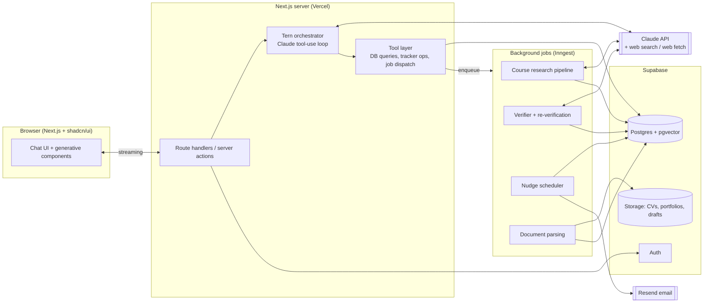
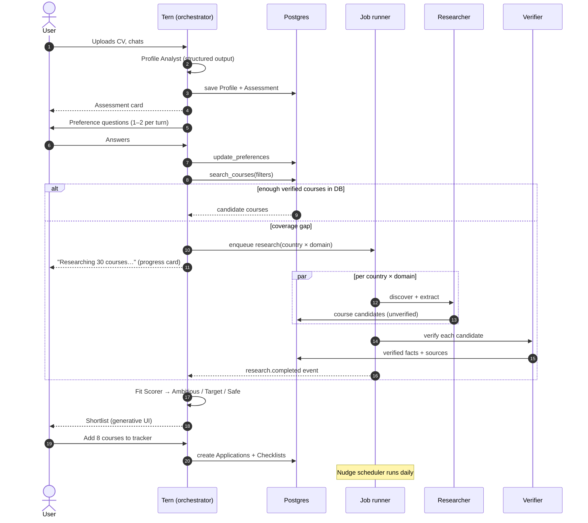
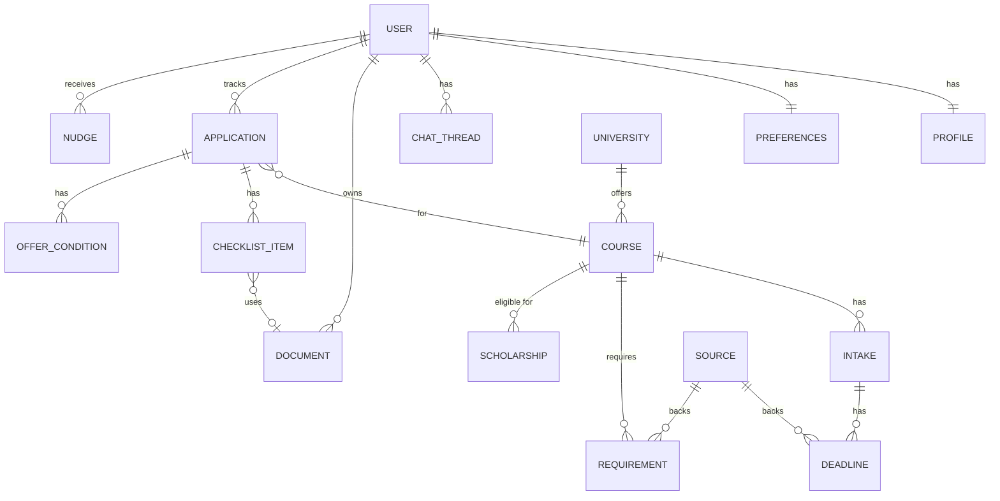
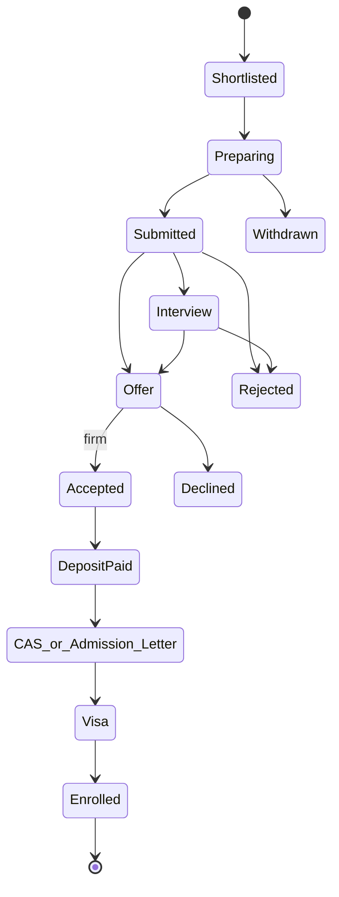
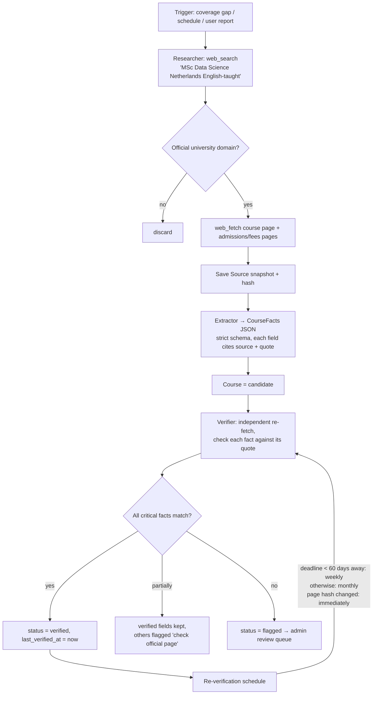

# Tern: Phase 2 System Design

| | |
|---|---|
| **Status** | Draft v1, for founder review |
| **Date** | 12 Nov 2026 |
| **Depends on** | [`01-prd.md`](01-prd.md) |

---

## 1. Design principles

1. **Facts come from the database, not from the model's memory.** The LLM never states a deadline, fee, requirement or URL unless it was read from a `Source`-backed record. The model reasons and writes; the data layer is the source of truth.
2. **One voice, many workers.** The user only ever talks to **Tern**, the orchestrator. Specialist workers run behind it, in parallel where they don't depend on each other.
3. **Workflow first, agent where needed.** Steps that are deterministic, such as the reminder schedule, tracker state changes and checklist generation, are plain code. LLM agents are used only for open-ended work: research, extraction, judgement and writing.
4. **Shared course database.** Each course is researched and verified once and then reused by every user. This is how accuracy, speed and cost all scale.
5. **Human in control.** Tern drafts and reminds. The user submits, sends and pays.
6. **Simple to start.** One Next.js app, one Postgres database and one job runner. No microservices in v1.

---

## 2. High-level architecture



---

## 3. Agent architecture

### 3.1 Agents and model choice

The models are set in one config file and can be changed after we measure quality and cost in the evals.

| Agent | Kind | Default model | Effort | Tools |
|---|---|---|---|---|
| **Tern (orchestrator)** | Long-running chat agent | `claude-opus-5-5` | medium | All app tools (§4); spawns workers |
| **Profile Analyst** | Single structured call | `claude-opus-5-5` | medium | none (CV/portfolio passed in as documents); returns `Profile` JSON + assessment |
| **Preference Interviewer** | Handled *inside* the orchestrator through `update_preferences` | (orchestrator) | — | — |
| **Course Researcher** | Agentic, runs as a job | `claude-sonnet-5-5` | medium | `web_search`, `web_fetch` (official domains), `upsert_course_candidate` |
| **Requirements Extractor** | Single structured call per page | `claude-haiku-5-5` | low | none; page text in → `CourseFacts` JSON out (strict schema) |
| **Verifier** | Agentic, runs as a job | `claude-sonnet-5-5` | high | `web_fetch`, `mark_fact_verified`, `flag_fact` |
| **Fit Scorer** | Hybrid: code computes the score, the LLM writes the reason | code + `claude-haiku-5-5` | low | none |
| **Document Coach** | Chat sub-flow / single call | `claude-opus-5-5` | high | `get_course_facts`, `save_document_version` |
| **Visa Agent** | Template + LLM personalisation | `claude-sonnet-5-5` | medium | `get_visa_template`, `web_fetch` (gov domains only) |
| **Nudge writer** | Batch job | `claude-haiku-5-5` | low | none |

Every request that names an Opus or Sonnet model sets the server-side `fallbacks: "default"` option (beta `server-side-fallback-2026-07-01`). Every response checks `stop_reason` before reading the content.

### 3.2 Orchestration flow



### 3.3 Why this shape
- **The orchestrator stays in the main thread**, so the user sees one consistent personality and conversation history.
- **Research runs in background jobs**, not inside the chat request. It can take 1–5 minutes, has to survive refreshes, and its results are shared across users. The UI shows live progress through Supabase Realtime.
- **The Verifier is independent of the Researcher.** It uses a different prompt and re-fetches the page itself, so an extraction error isn't rubber-stamped.
- **Fit scoring is mostly code.** The score is explainable and repeatable, and the LLM only writes the one-line reason.

### 3.4 Build approach (Claude API)
- **SDK:** `@anthropic-ai/sdk` (TypeScript). The **Tool Runner** (`client.beta.messages.toolRunner` + `betaZodTool`) drives the orchestrator and the agentic workers; its per-turn hooks handle logging, cost metering and approval gates.
- **Streaming** for every chat response (`messages.stream`), with `eager_input_streaming` on client tools and the tool input validated before it runs.
- **Structured outputs** (`output_config.format`) for the Profile, CourseFacts, Assessment and FitReason so the shapes are guaranteed.
- **Server tools:** `web_search_20260209` and `web_fetch_20260209`. `allowed_domains` restricts the Verifier and Visa agents to official university and government domains.
- **Prompt caching** on the stable prefix (system prompt + tool definitions + profile summary). Volatile content goes after the last breakpoint.
- **Long conversations:** **compaction** (beta) once a chat thread grows large. The application state lives in the DB anyway, so nothing important exists only in chat history.
- **Considered and not chosen for v1: Managed Agents.** It would host the agent loop and a sandbox for us, but our tools are mainly DB operations inside our own app, so a self-hosted Tool Runner is simpler. We'll revisit it if research jobs grow complex.

---

## 4. Orchestrator tool surface

These are the tools Tern can call. All are typed with Zod and marked `strict: true`.

| Tool | Purpose | Side effects |
|---|---|---|
| `get_profile` / `update_profile` | Read and patch the structured profile | DB write |
| `analyze_documents` | Run the Profile Analyst on uploaded files | DB write |
| `update_preferences` | Save interview answers | DB write; may trigger a shortlist refresh |
| `search_courses` | Query verified courses (filters + vector search on course descriptions) | read |
| `request_research` | Enqueue research for uncovered country × domain pairs | enqueue job |
| `score_and_bucket` | Run the fit scorer for a set of courses | read/compute |
| `show_shortlist` / `show_course` / `compare_courses` | Return a **UI payload** the client renders as a component | none |
| `add_to_tracker` | Create an Application + checklist from course requirements | DB write |
| `update_application_status` / `update_checklist_item` | Move the pipeline along | DB write |
| `get_timeline` | Upcoming deadlines across all applications | read |
| `draft_document` | Run the Document Coach (SOP, LOR brief, CV) | DB write (new version) |
| `get_visa_checklist` | Country template + personalisation | read/DB write |
| `report_data_issue` | User reports a wrong fact → re-verification job | enqueue job |

**Generative UI pattern:** UI tools return `{ component: "ShortlistTable", props: {...} }`. The client keeps a registry that maps component names to React components, so the model chooses *what* to show and our code controls *how* it looks.

---

## 5. Data model

The tables are Postgres, accessed through Drizzle ORM. Shared data is separated from per-user data.



### 5.1 Shared knowledge base (all users)

| Table | Key fields |
|---|---|
| `university` | id, name, country, city, official_domain, rankings (jsonb, with source), type (public/private) |
| `course` | id, university_id, name, award (MA/MSc/MBA…), subject_tags[], duration_months, mode, language, course_url, apply_url, apply_portal (direct/UCAS/uni-assist/Studielink/Campus France), tuition_intl {amount, currency, year}, tuition_eu, embedding (vector), **status** (candidate/verified/stale/flagged), last_verified_at |
| `intake` | id, course_id, start_month, year |
| `deadline` | id, intake_id, kind (round_1/final/scholarship/deposit/non_eu), date, timezone, is_rolling, **source_id**, confidence, last_verified_at |
| `requirement` | id, course_id, kind (degree/gpa/english/portfolio/sop/lor/cv/interview/test/work_exp/other), spec (jsonb e.g. `{test:"IELTS",overall:6.5,min_band:6.0}`), **source_id**, confidence |
| `scholarship` | id, name, provider, amount, eligibility (jsonb), deadline, url, source_id |
| `source` | id, url, domain, fetched_at, content_hash, http_status, snapshot_path |
| `visa_template` | country, visa_type, steps (jsonb), fund_rules (jsonb), source_ids[], version, last_verified_at |

### 5.2 Per-user data (row-level security: owner only)

| Table | Key fields |
|---|---|
| `profile` | user_id, education[] (institution, degree, grade, scale, ects_equiv), experience[], skills[], tests[], portfolio_url, gaps, flags (visa_refusal, dependants), **field_confidence** (jsonb) |
| `assessment` | user_id, tier_by_country (jsonb), strengths[], gaps[] {issue, action, effort}, created_at |
| `preferences` | countries_ranked[], domains_ranked[], intake, budget {total, currency, funding}, duration_pref, career_goal, city_prefs, constraints |
| `application` | id, user_id, course_id, intake_id, bucket (ambitious/target/safe), fit_score, fit_reason, **status** (state machine below), muted |
| `checklist_item` | id, application_id, kind, title, due_date, status (todo/in_progress/done/na), document_id, referee {name, email}, notes |
| `offer_condition` | id, application_id, description, due_date, met |
| `document` | id, user_id, kind (cv/portfolio/transcript/sop/lor_brief/…), storage_path, version, parent_id, course_id |
| `nudge` | id, user_id, application_id, checklist_item_id, channel, scheduled_for, sent_at, kind, body |
| `chat_thread` / `chat_message` | conversation history (incl. UI payloads), compaction state |
| `usage_event` | user_id, kind (llm_call, search, research_job), model, tokens_in/out, cost_usd, created_at (**metering for future pricing**) |

### 5.3 Application state machine



`Offer` has a sub-type, *conditional* or *unconditional*. Conditional offers create `offer_condition` rows.

---

## 6. Course data and verification pipeline

This is the core of Tern's trust promise.



**Rules**
- **Critical facts** are application deadlines, the apply URL, tuition, the English requirement and required documents. A course can't appear in a shortlist as "verified" unless all critical facts are verified or explicitly marked "check official page".
- **Every fact stores a quote**: the exact sentence from the source page. The UI shows it on hover ("Source: ucl.ac.uk · verified 3 days ago").
- **Domain allowlist:** facts can only come from the university's `official_domain`, a national portal (UCAS, uni-assist, Studielink, Campus France, DAAD) or a government site (gov.uk, irishimmigration.ie, ind.nl, etc.).
- **Link checks:** a daily job sends a HEAD request to every `apply_url` and `course_url` in active applications. A 404 or redirect triggers re-verification.
- **User reports** jump the queue.
- **Seeding:** before launch, run research batch jobs (Message Batches API, 50% cost) over a seed list of the most-applied subjects × 5 countries, giving roughly 1,500–3,000 courses.

---

## 7. Background jobs (Inngest)

| Job | Trigger | Notes |
|---|---|---|
| `research.coverage` | `request_research` event | Fans out per country × domain; concurrency limit per domain to be polite |
| `course.verify` | after extraction; schedule; user report | Idempotent per course |
| `links.check` | daily cron | Active applications only |
| `nudges.plan` | daily cron (per user timezone) | Pure code: finds checklist items due at T-30/14/7/2 that aren't done |
| `nudges.send` | after plan | Haiku writes a short personalised body → Resend; respects mute and quiet hours |
| `digest.weekly` | Monday 08:00 in the user's timezone | Progress + top 3 actions |
| `documents.parse` | on upload | PDF/DOCX → text → Profile Analyst |
| `usage.rollup` | hourly | Aggregates `usage_event` per user per day |

---

## 8. Frontend architecture (summary; detailed in Phase 3)

- **Next.js 15 App Router**, TypeScript, Tailwind, **shadcn/ui**, light and dark themes.
- **Routes:** `/` (marketing), `/chat/[threadId]`, `/shortlist`, `/applications`, `/applications/[id]`, `/documents`, `/settings`.
- The **chat** streams through a route handler. Messages are a list of text blocks plus `ui` blocks rendered from the component registry.
- The **tracker and timeline** are also reachable outside chat (sidebar), so users can glance without asking.
- **Realtime:** Supabase Realtime channel per user for job progress and tracker updates.

---

## 9. Security and privacy

| Area | Approach |
|---|---|
| Auth | Supabase Auth (magic link + Google). Session cookies are httpOnly. |
| Isolation | Postgres **row-level security** on every per-user table. The service role is used only in jobs. |
| Files | Private storage bucket and short-lived signed URLs. Encrypted at rest. |
| PII to the LLM | Only what the task needs. Passport numbers are never sent. The orchestrator gets a profile *summary*, not raw documents. |
| Cross-user leakage | Shared data (courses) contains no user data. The LLM context is always built from one user's rows. |
| Prompt injection | Fetched web pages are treated as data. Extraction runs in a separate, tool-less call with a strict output schema, and agents that read the web can't write user data. |
| GDPR | Data export plus "delete my account and data" (hard delete, including storage). EU hosting region for the DB. Privacy policy before launch. |
| Regulated advice | Visa output = official checklist + sources + disclaimer. Refusals and complex cases → "speak to a regulated adviser". |
| Abuse / cost | Per-user rate limits and daily token budget (metered via `usage_event`). |

---

## 10. Cost and latency estimates (rough, to check in evals)

Model prices per 1M tokens (input/output): Opus 5.5 $4/$20 · Sonnet 5.5 $2/$10 · Haiku 5.5 $0.10/$0.50. Cache reads are much cheaper than fresh input.

| Activity (per active user per month) | Rough tokens | Est. cost |
|---|---|---|
| Chat with Tern (~40 turns, cached prefix) | ~1.2M in (mostly cache reads), ~40K out | ~$1.00 |
| Profile analysis (once) | ~20K in, ~4K out | ~$0.16 |
| SOP drafts and critiques (~6) | ~150K in, ~30K out | ~$1.20 |
| Nudges + digest (Haiku) | ~60K in, ~10K out | < $0.02 |
| Research (amortised: shared DB, most users hit cache) | — | ~$0.20 |
| **Total** | | **~$2.50 / user / month** (target < $3) |

The one-off seed research (~2,000 courses × ~5 pages with Sonnet + Batches) is estimated at a few hundred dollars. These are planning numbers; we'll measure real `usage_event` costs during the beta.

**Latency targets:** first token in chat < 2 s; profile analysis < 30 s; shortlist from existing data < 10 s; cold research shown as a progress card (1–5 min) while the chat stays usable.

---

## 11. Observability and quality

- **Logging:** every LLM call → `usage_event` (model, tokens, cost, latency, stop_reason).
- **Tracing:** OpenTelemetry later. For v1, structured logs + Inngest run history.
- **Evals (Phase 4 detail):** synthetic personas → expected properties (courses real, links resolve, deadlines match sources, budget respected, no invented facts in SOPs). They run in CI on prompt and model changes.
- **Admin review queue:** flagged courses and user-reported issues, in a simple internal page.

---

## 12. Repository structure (proposed)

```
tern/
├─ apps/web/                  # Next.js app
│  ├─ app/                    # routes (chat, shortlist, applications, documents, settings)
│  ├─ components/ui/          # shadcn components
│  ├─ components/gen/         # generative UI components (ShortlistTable, CourseCard, Timeline…)
│  └─ lib/
├─ packages/
│  ├─ agents/                 # orchestrator, workers, prompts, tool definitions, model config
│  ├─ db/                     # Drizzle schema, migrations, RLS policies, seed
│  ├─ jobs/                   # Inngest functions
│  └─ evals/                  # personas, fixtures, eval runner
├─ docs/
└─ .github/workflows/         # lint, typecheck, test, evals
```

pnpm workspaces + Turborepo. Deployed on Vercel with Supabase in an EU region.

---

## 13. Decisions to confirm
1. **Stack:** Next.js + Supabase + Inngest + Resend on Vercel. *Recommended*: managed services keep the MVP fast and cheap.
2. **Model mix:** Opus 5.5 for the user-facing conversation and writing, Sonnet 5.5 for research and verification, Haiku 5.5 for extraction and nudges. Can be tuned after the evals.
3. **Seed scope:** pre-seed the course DB before launch (recommended), rather than researching everything on demand.

## 14. Next step
**Phase 3 is the UX design:** information architecture, key screens and states, and the generative UI component inventory mapped to shadcn.
