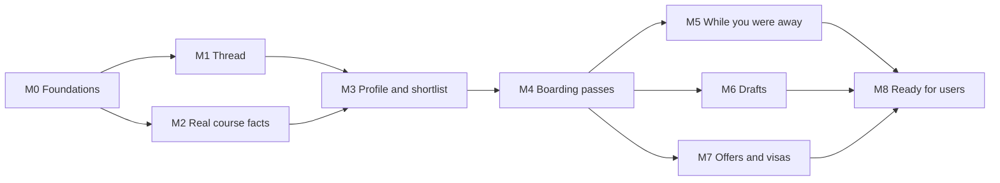

# Tern: Phase 4 Build Plan

| | |
|---|---|
| **Status** | Draft v1, for founder review |
| **Date** | 13 Nov 2026 |
| **Depends on** | [`01-prd.md`](01-prd.md), [`02-system-design.md`](02-system-design.md), [`03-ux.md`](03-ux.md), [`../DESIGN.md`](../DESIGN.md) |

---

## 1. How we build

- **One milestone at a time, each ending in something you can open and use.** Nothing is "90% done" across five areas.
- **The riskiest thing first.** Tern's promise is that facts are real. The research and verification pipeline is proven in milestone 2, before any polish.
- **Evals before features.** The test profiles and accuracy checks are written in milestone 2 and run on every change after that.
- **Every screen follows the 7-step workflow** in `CLAUDE.md` (spec, design, copy, build, look at it, review, code review).
- **Small commits to `main` behind feature flags** until the beta. Each milestone ends with a tagged release and a short demo note in `docs/demos/`.

---

## 2. Milestones

Status of all milestones: **Not started**.

### M0. Foundations
*You can open a deployed, empty Tern and sign in.*

| # | Task | Done when |
|---|---|---|
| 0.1 | Monorepo: pnpm + Turborepo, `apps/web`, `packages/{agents,db,jobs,evals}` | `pnpm build` and `pnpm test` pass |
| 0.2 | Next.js app with Tailwind and shadcn/ui, themed from `DESIGN.md` tokens, both themes, both fonts | A `/design` page shows every token and base component |
| 0.3 | Supabase project (EU region), Drizzle schema for all tables in the system design, row-level security | A test proves user A cannot read user B's rows |
| 0.4 | Sign-in with email link and Google | A new user can sign in and out |
| 0.5 | Inngest and Resend wired with one hello-world job and one test email | Job runs on a schedule; email arrives |
| 0.6 | CI: lint, typecheck, unit tests, preview deploys on Vercel | A pull request shows green checks and a preview link |
| 0.7 | `usage_event` logging wrapper around every Claude call | A call writes model, tokens, cost and latency |

### M1. The thread
*You can talk to Tern. It streams replies and renders components.*

| # | Task | Done when |
|---|---|---|
| 1.1 | Thread layout: header, headline, composer with suggestion pills, no navigation | Matches the preview at 390px and 1280px in both themes |
| 1.2 | Streaming chat route with the orchestrator and prompt caching | First words appear in under 2 seconds |
| 1.3 | Component registry: the model picks a component, our code renders it | A test tool call renders a `Run` and a result list |
| 1.4 | `Run` component fed by live job progress (Supabase Realtime) | Steps tick in as a background job reports them |
| 1.5 | Sheet primitive (right on desktop, bottom on phones, focus trap, Escape) | Keyboard-only test passes |
| 1.6 | Conversation storage and reload | Refreshing the page restores the thread |

### M2. Real course facts (the core risk)
*Ask for courses in one country and subject, and get only real, sourced ones.*

| # | Task | Done when |
|---|---|---|
| 2.1 | Eval harness and the 8 test profiles (section 4) | `pnpm evals` prints a scorecard |
| 2.2 | Researcher: web search limited to official university domains, saves page snapshots | 20 real course pages captured for one subject in the UK |
| 2.3 | Extractor: page text to `CourseFacts` with a quote for every fact | Schema-valid output for all 20 pages |
| 2.4 | Verifier: independent re-fetch, checks each fact against its quote | A deliberately wrong fact is caught and flagged |
| 2.5 | Course statuses (candidate, verified, stale, flagged) and the "not checked yet" path | Unverified facts never render as normal facts |
| 2.6 | Hand-checked golden set: 50 courses across the 5 countries, facts confirmed by a person | Pipeline scores ≥ 95% on deadlines, 100% on links |
| 2.7 | `Fact` + source component in the UI | Tapping a fact shows quote, page and date |
| 2.8 | Internal review page for flagged courses | A flagged course can be fixed or rejected |

**Gate:** if 2.6 misses its targets, we stop and fix the pipeline before M3. Nothing else matters if this fails.

### M3. Profile and shortlist
*Upload a CV, answer a few questions, get a balanced shortlist.*

| # | Task | Done when |
|---|---|---|
| 3.1 | First-visit screen and CV upload (PDF, Word), parsing job | A CV becomes a structured profile in under 30 seconds |
| 3.2 | Profile Analyst and the assessment lists | At least 3 strengths and 3 fixes, each fix with an action |
| 3.3 | Passport sheet: view and edit everything Tern knows | Editing a field updates the profile |
| 3.4 | Preference questions inside the conversation | Completed in about 10 turns; skipped answers get stated defaults |
| 3.5 | Fit scoring in code, one-line reason from the model | Same input gives the same bucket every time |
| 3.6 | Shortlist results in the thread, grouped Stretch / Good match / Safe | 12–25 courses, inside budget unless marked stretch |
| 3.7 | Seed the course database for the top subjects in all 5 countries (batch jobs) | About 1,500 verified courses |
| 3.8 | Coverage gaps trigger research on demand | A subject with no data produces results within 5 minutes |

### M4. Boarding passes
*Track courses and see what is due.*

| # | Task | Done when |
|---|---|---|
| 4.1 | "Track" creates an application and its checklist from the course's requirements | Checklist matches the verified requirements |
| 4.2 | Boarding pass and stamp components | Match the preview; status is announced to screen readers |
| 4.3 | Boarding pass sheet: apply link, checklist, facts | Ticking items updates "what's left" |
| 4.4 | Application status flow with the allowed moves only | Invalid moves are rejected by a test |
| 4.5 | "Needs you this week" and the headline countdown | Correct across time zones |
| 4.6 | "This looks wrong" on any fact, which triggers a re-check | A report produces a re-verification job |

### M5. Tern works while you are away
*Reminders arrive, and the home screen tells you what changed.*

| # | Task | Done when |
|---|---|---|
| 5.1 | Scheduled re-verification (weekly inside 60 days of a deadline, otherwise monthly) and daily link checks | A changed deadline updates the pass |
| 5.2 | "While you were away" feed built from real events | A moved deadline appears as a red row |
| 5.3 | Reminder planner in code (30, 14, 7 and 2 days) and the weekly digest | Only unfinished items trigger emails |
| 5.4 | Email templates in Tern's voice, with mute per application | Emails render in Gmail and Outlook, light and dark |

### M6. Drafts
*Tern helps write the statement, the reference request and the CV.*

| # | Task | Done when |
|---|---|---|
| 6.1 | Draft sheet with versions | Every save is a version you can return to |
| 6.2 | Statement of purpose: outline, draft, critique, tied to the course's own page | Uses only facts from the profile; respects the word limit |
| 6.3 | Reference request and briefing pack for referees | Copy and download work; Tern never sends |
| 6.4 | CV tailoring per course | Suggestions cite the course requirement they answer |
| 6.5 | Notice when a university publishes an AI-use policy | The policy is shown with its source before drafting |

### M7. Offers and visas
*From offer to departure.*

| # | Task | Done when |
|---|---|---|
| 7.1 | Offer conditions on the pass, with their own deadlines and reminders | A conditional offer creates condition rows |
| 7.2 | Compare sheet for offers and courses (up to 4) | Total cost and conditions line up side by side |
| 7.3 | Visa checklists for the UK, Ireland, Germany, the Netherlands and France, from government sources only | Every step links to an official page |
| 7.4 | Disclaimer and referral to a regulated adviser for refusals and complex cases | Shown whenever a profile has a refusal flag |

### M8. Ready for real users
*Safe to hand to strangers.*

| # | Task | Done when |
|---|---|---|
| 8.1 | Settings: reminders, export my data, delete my account and data | Deletion removes database rows and files |
| 8.2 | Privacy policy and terms, cookie-free analytics | Published and linked |
| 8.3 | Rate limits and a per-user daily budget | A runaway session is stopped politely |
| 8.4 | Error tracking, uptime checks, job failure alerts | A forced failure produces an alert |
| 8.5 | Full accessibility pass and design critique on every screen | No open AA issues |
| 8.6 | Security review and a prompt-injection test set against the research agents | No user data can be written by a web-reading agent |
| 8.7 | Landing page (this is where the animated libraries and the taste skill are used) | Live on the domain |
| 8.8 | Closed beta with 20–30 applicants | Feedback collected and triaged |

---

## 3. Order and dependencies

- M1 and M2 can be built side by side after M0.
- M5, M6 and M7 are independent of each other after M4. If time is short, M7 can ship after the beta opens, because early beta users will not have offers yet.
- **First usable version for you to test on yourself: end of M4.** You can upload your CV, get a real shortlist and track applications.

---

## 4. Testing and evaluation

### Test profiles
Eight invented applicants, stored in `packages/evals/personas/`:

| # | Profile | What it tests |
|---|---|---|
| 1 | Final-year CS undergraduate, 8.1 CGPA, UK and Germany, mid budget | The common case |
| 2 | Banking operations, 6 years, switching to analytics | Experience over grades |
| 3 | UX designer with a portfolio, UK and the Netherlands | Portfolio requirements |
| 4 | Strong grades, very low budget, needs funding | Low-tuition and scholarship options |
| 5 | Two-year study gap, earlier UK visa refusal, one dependant | Caution and referral wording |
| 6 | Nurse, wants public health, Ireland | Non-tech subject coverage |
| 7 | Average grades with backlogs, wide country choice | Honest "safe" options |
| 8 | No English test, tight timeline (first deadline in 3 weeks) | Urgency and ordering |

### What is measured on every change
| Check | How | Target |
|---|---|---|
| Links open an official page | Automated request to every link in every shortlist | 100% |
| Deadlines, fees and English requirements match the source | Compared with the hand-checked golden set | ≥ 95% |
| No fact without a source | Every rendered fact has a source row | 100% |
| Budget respected | Shortlist totals compared with the profile's budget | 100% unless marked stretch |
| Balanced list | Each shortlist has all three fit groups | 100% |
| Nothing invented in drafts | Every claim in a statement traces to the profile | 100% |
| No promise of admission | Wording check on Tern's replies | 100% |
| Visa content is checklist-only, with disclaimer | Wording check on profiles 5 and others | 100% |
| Cost per profile run | Summed from `usage_event` | Tracked; alert above budget |

### Other tests
- **Unit tests** for everything that is plain code: reminder dates, status moves, fit scoring, time zones.
- **End-to-end tests** (Playwright) for the main journeys at phone and desktop sizes.
- **Screenshot checks** of every component in both themes.
- **Prompt-injection set:** web pages written to trick the agents, which must change nothing.

---

## 5. Risks to the plan

| Risk | Effect | Response |
|---|---|---|
| Verification accuracy misses the target in M2 | Everything after it is built on bad data | Hard gate after 2.6; narrow to fewer countries before lowering the bar |
| University sites block or rate-limit fetching | Research and re-checks slow down | Polite crawl rates, caching, on-demand fetching; reduce seed size |
| Seeding costs more than expected | Budget | Seed fewer subjects first; measure cost on 50 courses before running the full batch |
| The no-navigation design confuses first-time users | Low activation | Test with 5 people at the end of M4; the fixed Passport button and suggestion pills are the fallback, and a small "open" menu is the next step if needed |
| Scope creep in drafts (M6) | Delays the beta | Statement of purpose first; CV tailoring can follow the beta |

---

## 6. What I need from you before M0

Accounts are in your name so you own everything. Each takes a few minutes.

1. **Anthropic API account** with billing, for the Claude models.
2. **Supabase** project (choose an EU region).
3. **Vercel** account connected to the GitHub repo.
4. **Inngest** and **Resend** accounts (free tiers are enough to start).
5. **A domain name** for Tern, once you choose one.

Keys are never pasted into chat. I will ask for each one through the secure credential form when it is first needed.

---

## 7. Next step

Phase 5: start building at M0.
